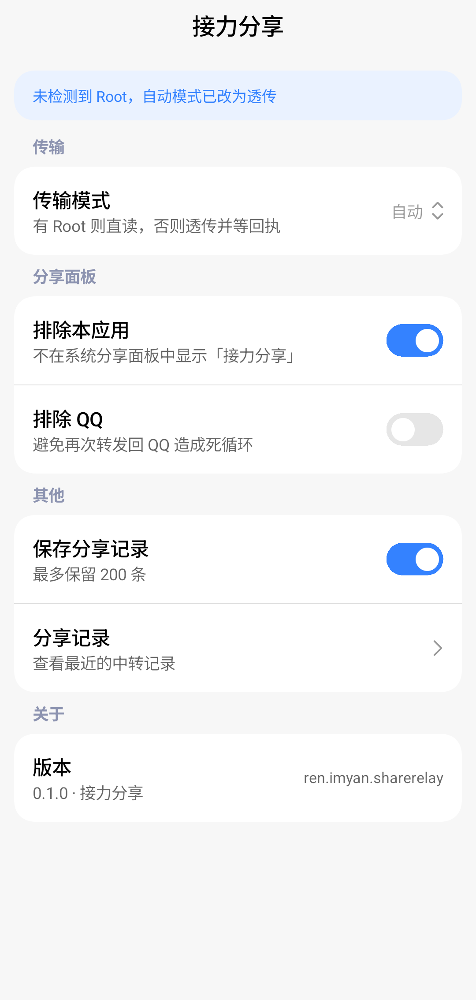
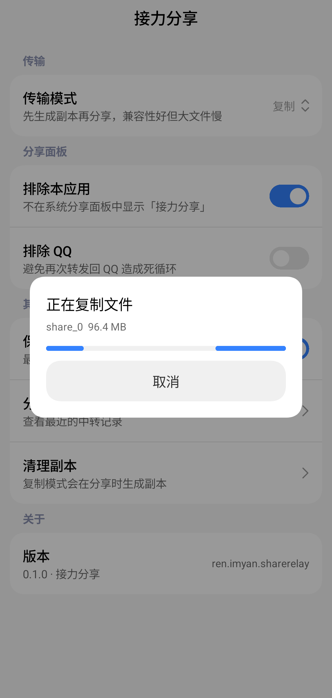
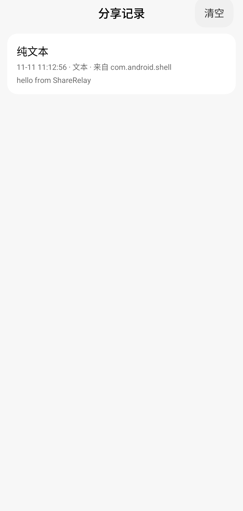
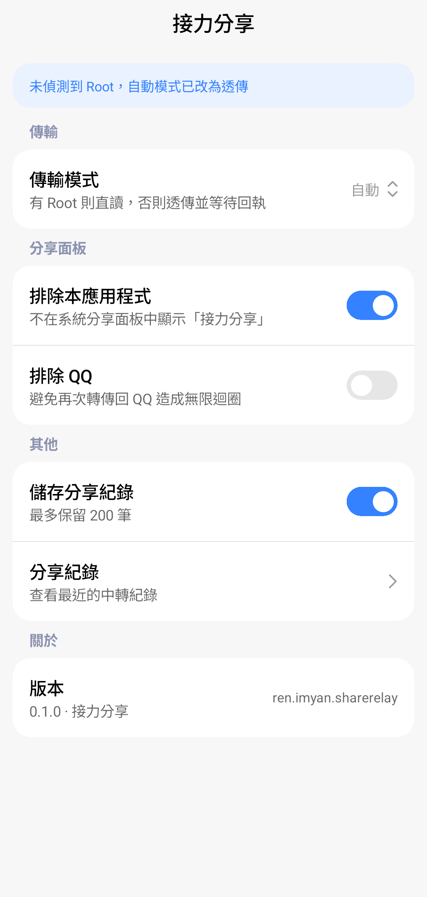
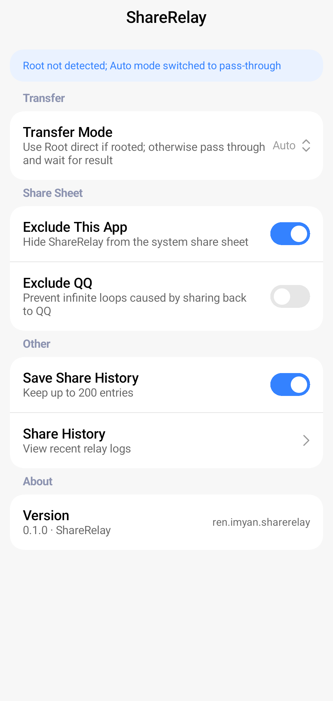

<p align="center">
  
</p>

<h1 align="center">接力分享 ShareRelay</h1>

<p align="center">
  <b>简体中文</b> · <a href="README_EN.md">English</a>
</p>

<p align="center">
  
  
  
  
</p>

> QQ、微信的分享面板只列白名单应用，图片和文件经常没法分享到飞书、邮件、蓝牙、笔记。
> **接力分享**把自己注册成系统分享目标：你在 QQ 里选「接力分享」，它再把内容交给 Android 系统分享面板，于是所有声明了对应入口的应用都出现了。

<p align="center">
  
</p>

## 功能

- **完整的分享入口**：注册 `ACTION_SEND`、`ACTION_SEND_MULTIPLE`、`ACTION_VIEW`，覆盖图片、视频、音频、文件和纯文本
- **四种传输模式**：自动 / Root 直读 / 透传 / 复制，速度与兼容性按需取舍
- **复制进度**：大文件复制时显示进度卡片，可随时取消
- **分享历史**：记录最近 200 条中转记录，支持一键清空
- **防回环**：分享面板里可排除接力分享自身，也可排除 QQ，避免来回转发
- **现代界面**：Jetpack Compose + [Miuix](https://github.com/compose-miuix-ui/miuix)（HyperOS 风格），自动适配深浅色
- **三种语言**：简体中文 / 繁體中文 / English，支持 Android 13+ 应用级语言切换
- **干净**：不申请网络权限，无统计 SDK，数据不出本机

<p align="center">
  &nbsp;&nbsp;
  
</p>

## 工作原理

```
QQ / 微信的分享面板
  └─ ACTION_SEND / SEND_MULTIPLE / VIEW (content://com.tencent.mobileqq.fileprovider/…)
       └─ 接力分享 RelayActivity
            ├─ ① 取数：Root 直读 / 原样透传 / 复制到私有目录
            └─ ② Intent.createChooser() → 系统分享面板 → 任意 App
```

几个关键点：

1. **QQ 的面板是自绘的**：它自己调 `queryIntentActivities()`，再按白名单裁剪；而系统分享面板会列出所有声明了对应 `intent-filter` 的应用。接力分享只是把这一步"还"给系统。
2. **必须设置 ClipData**：`Intent.createChooser` 只搬运 `ClipData` 里的 URI 授权，不会处理 `EXTRA_STREAM`。所以 `EXTRA_STREAM`、`clipData`、`FLAG_GRANT_READ_URI_PERMISSION` 三者要同时设置，否则目标应用会抛 `SecurityException` 或者读到 0 字节。
3. **透传必须等回执**：来源应用给我们的 `content://` 是临时授权，绑定在接收方 Activity 的生命周期上。调起分享面板后立刻 `finish()`，授权就会被回收，目标应用只能读到空文件。所以透传模式会保持页面存活，等分享面板关闭后再退出。
4. **Root 直读**：用 `su` 直读来源文件，再经由自带的 `RelayProvider` 供数，零拷贝、不需要等回执。
5. **`file://` 兜底**：Android 7.0 起跨应用暴露 `file://` 会被 `FileUriExposedException` 拦截，遇到这类来源会自动改为复制。

## 传输模式

| 模式 | 行为 | 需要 Root | 等待回执 |
| --- | --- | --- | --- |
| **自动**（默认） | 有 Root 时直读，否则透传 | 否 | 视情况 |
| **Root 直读** | `su` 读原文件 → 自带 Provider 供数 → 立即结束 | 是 | 否 |
| **透传** | 原样转发来源 URI，保持页面直到面板关闭 | 否 | 是 |
| **复制** | 先复制到私有目录再分享，兼容性更好但大文件较慢 | 否 | 否 |

未授权 Root 时，选择「Root 直读」或「自动」会在设置页顶部显示提示横幅，并自动降级为透传，不影响使用。

## 安装

1. 从 [Releases](../../releases) 下载最新的 `ShareRelay-*.apk`；
2. 安装后打开应用，确认传输模式（默认「自动」即可）；
3. 在 QQ / 微信 / 相册里长按文件 → 分享 → 找到「接力分享」。

如果暂时没有 Releases，也可以按下面的「构建」章节自行编译。

也可以用 ADB：

```bash
adb install -r ShareRelay-0.1.0.apk
```

> 正式版和调试版签名不同：如果之前装过 debug 包，需要先 `adb uninstall ren.imyan.sharerelay` 再安装正式版。

## 构建

环境要求：

- **JDK** 17 或更高
- **Android SDK**：`platforms;android-37`（Miuix 0.9.0 要求 `compileSdk 37`；工程 minSdk 24 / targetSdk 36）
- **Gradle** 8.13（仓库自带 wrapper）

```bash
git clone <repo-url> ShareRelay
cd ShareRelay
echo "sdk.dir=/path/to/Android/Sdk" > local.properties
./gradlew assembleDebug
# 产物：app/build/outputs/apk/debug/app-debug.apk
# Windows 用户用 gradlew.bat assembleDebug
```

> AGP 8.13.1 官方最高支持到 API 36，`gradle.properties` 里配置了 `android.suppressUnsupportedCompileSdk=37` 以允许用 37 编译。发布签名用的 `keystore.properties` 和密钥库文件不入库。

## 项目结构

```
├── app/src/main/
│   ├── java/ren/imyan/sharerelay/
│   │   ├── MainActivity.kt      # 设置页（Compose + Miuix）
│   │   ├── LogActivity.kt       # 分享记录页
│   │   ├── RelayActivity.kt     # 分享中转核心：取数、进度、转发
│   │   ├── RelayProvider.kt     # 只读 ContentProvider：副本 / Root 虚拟文件
│   │   ├── Forwarder.kt         # 构造系统分享 Intent 与 ClipData
│   │   ├── SharePayload.kt      # 分享内容解析
│   │   ├── RootHelper.kt        # su 执行与 FileProvider 路径解析
│   │   ├── Settings.kt          # 偏好设置
│   │   └── ShareLog.kt          # 分享历史（JSON 文件）
│   └── res/
│       ├── values*/strings.xml  # 简体中文 / 繁體中文 / English
│       └── xml/locales_config.xml
├── docs/
│   ├── copy-review.md           # 文案审核记录
│   └── screenshots/             # README 截图
└── dist/                        # 已签名的发布包
```

## 多语言

| 语言 | 资源目录 |
| --- | --- |
| 简体中文（默认） | `app/src/main/res/values/strings.xml` |
| 繁體中文（台灣） | `app/src/main/res/values-zh-rTW/strings.xml` |
| English | `app/src/main/res/values-en/strings.xml` |

Android 13+ 可以在「设置 → 应用 → 接力分享 → 语言」里单独切换（通过 `res/xml/locales_config.xml` 声明）。

<p align="center">
  
  
</p>

## 已知限制

- **Root 直读**需要在 Magisk / KernelSU / APatch 等管理器里给接力分享授权；未授权时会自动降级，不影响使用。
- 来源 URI 如果不是 `FileProvider` 类型（例如相册的 `MediaStore` URI），`RootHelper` 解析不到真实路径，会自动退回复制模式。
- 复制 GB 级文件的时间取决于存储速度，进度卡片可以取消。
- 系统分享面板由系统和 ROM 提供，个别深度定制 ROM 可能只展示常用应用，这一点应用本身无法控制。

## 致谢

- [Miuix](https://github.com/compose-miuix-ui/miuix)：HyperOS 风格的 Compose Multiplatform UI 组件库
- [Jetpack Compose](https://developer.android.com/jetpack/compose)

## License

[MIT](LICENSE)


