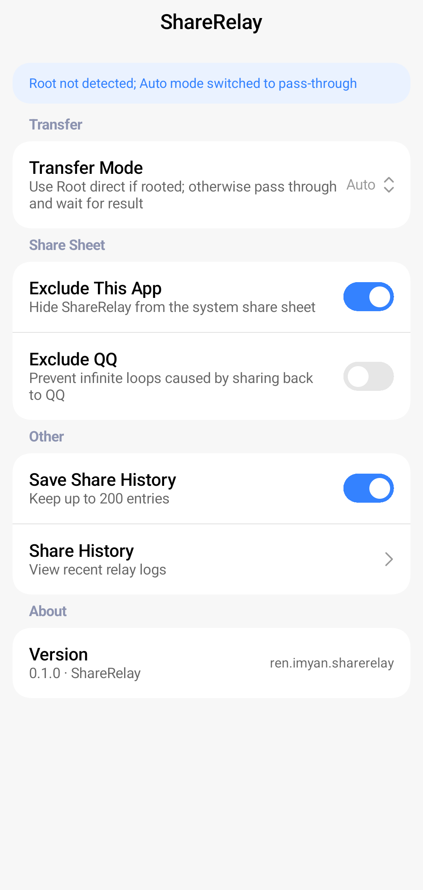
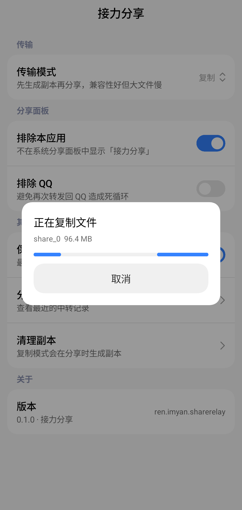
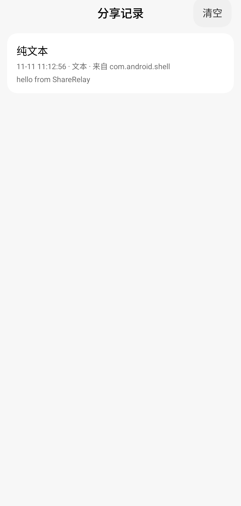
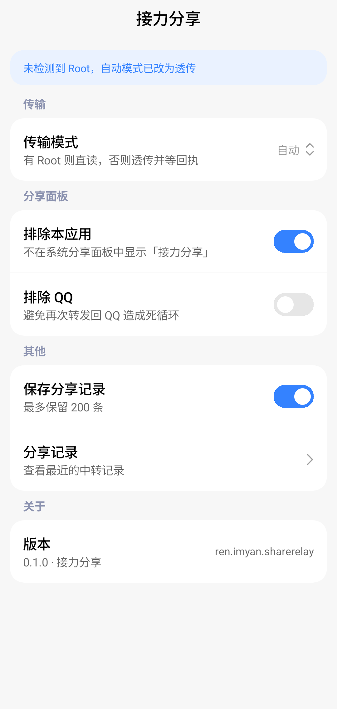
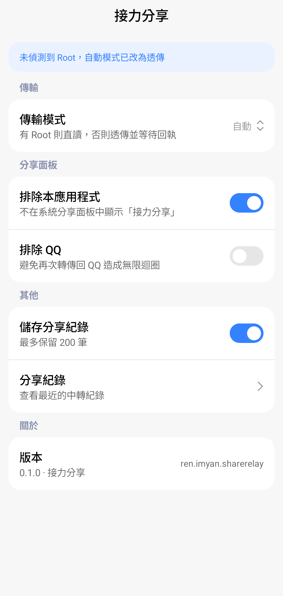

<p align="center">
  
</p>

<h1 align="center">ShareRelay</h1>

<p align="center">
  <a href="README.md">简体中文</a> · <b>English</b>
</p>

<p align="center">
  
  
  
  
</p>

> QQ and WeChat draw their own share panels and only list whitelisted apps, so images and files often can't be sent to Feishu, Mail, Bluetooth or Notes.
> **ShareRelay** registers itself as a system share target: pick it in QQ's panel and it hands the content over to the Android share sheet, where every app that declares a matching share intent shows up.

<p align="center">
  
</p>

## Features

- **Full share entry points**: handles `ACTION_SEND`, `ACTION_SEND_MULTIPLE` and `ACTION_VIEW` for images, videos, audio, arbitrary files and plain text
- **Four transfer modes**: Auto / Root direct / Pass-through / Copy — trade speed for compatibility as needed
- **Copy progress**: a cancellable progress card while large files are copied
- **Share history**: keeps the last 200 relays locally, one tap to clear
- **Loop prevention**: optionally hide ShareRelay itself and QQ from the system share sheet
- **Modern UI**: Jetpack Compose + [Miuix](https://github.com/compose-miuix-ui/miuix) (HyperOS style), light and dark themes
- **Three languages**: 简体中文 / 繁體中文 / English, with Android 13+ per-app language switching
- **Clean**: no network permission, no analytics, nothing leaves the device

<p align="center">
  &nbsp;&nbsp;
  
</p>

## How it works

```
QQ / WeChat share panel
  └─ ACTION_SEND / SEND_MULTIPLE / VIEW (content://com.tencent.mobileqq.fileprovider/…)
       └─ ShareRelay RelayActivity
            ├─ ① Fetch: Root direct / pass-through / copy to private storage
            └─ ② Intent.createChooser() → system share sheet → any app
```

A few notes from building it:

1. **QQ's share panel is custom-built.** It calls `queryIntentActivities()` and filters the result with its own whitelist. The system share sheet lists every app that declares the matching `intent-filter`; ShareRelay simply hands the decision back to the system.
2. **ClipData is mandatory.** `Intent.createChooser` only propagates URI grants carried in `ClipData`; it does not look at `EXTRA_STREAM`. Set `EXTRA_STREAM`, `clipData` and `FLAG_GRANT_READ_URI_PERMISSION` together, or the target app gets a `SecurityException` or an empty file.
3. **Pass-through must wait for the result.** The source app grants our activity a temporary `content://` permission tied to its lifetime. Calling `finish()` right after launching the sheet revokes the grant and the target reads 0 bytes, so pass-through keeps the activity alive until the sheet closes.
4. **Root direct** reads the original file with `su` and serves it through our own `RelayProvider` — zero copy, no waiting for a result.
5. **`file://` fallback.** Since Android 7.0 a `file://` URI cannot be exposed across apps (`FileUriExposedException`), so such sources are copied first.

## Transfer modes

| Mode | Behaviour | Needs Root | Waits for result |
| --- | --- | --- | --- |
| **Auto** (default) | Root direct when available, otherwise pass-through | No | Depends |
| **Root direct** | `su` reads the file → served by our provider → finish immediately | Yes | No |
| **Pass-through** | Forward the source URI as-is, keep the activity alive until the sheet closes | No | Yes |
| **Copy** | Copy into private storage first, then share — most reliable, slower for large files | No | No |

If Root is not granted, selecting **Root direct** or **Auto** shows a warning banner in Settings and automatically falls back to **Pass-through**.

## Install

1. Download the latest `ShareRelay-*.apk` from [Releases](../../releases);
2. Open the app and keep the default transfer mode (Auto);
3. Long-press a file in QQ / WeChat / Gallery → Share → pick ShareRelay.

If there is no Release yet, build it yourself with the steps below.

Or install with ADB:

```bash
adb install -r ShareRelay-0.1.0.apk
```

> Release and debug builds are signed with different keys. If you previously installed a debug build, run `adb uninstall ren.imyan.sharerelay` first.

## Build

Requirements:

- **JDK** 17+
- **Android SDK**: `platforms;android-37` (Miuix 0.9.0 requires `compileSdk 37`; project is minSdk 24 / targetSdk 36)
- **Gradle** 8.13 (wrapper included)

```bash
git clone <repo-url> ShareRelay
cd ShareRelay
echo "sdk.dir=/path/to/Android/Sdk" > local.properties
./gradlew assembleDebug
# output: app/build/outputs/apk/debug/app-debug.apk
# on Windows use gradlew.bat assembleDebug
```

> AGP 8.13.1 officially supports up to API 36; `gradle.properties` sets `android.suppressUnsupportedCompileSdk=37` so the project can compile against 37. The release signing config (`keystore.properties`) and the keystore itself are not committed.

## Project structure

```
├── app/src/main/
│   ├── java/ren/imyan/sharerelay/
│   │   ├── MainActivity.kt      # Settings (Compose + Miuix)
│   │   ├── LogActivity.kt       # Share history
│   │   ├── RelayActivity.kt     # Relay core: fetch, progress, forward
│   │   ├── RelayProvider.kt     # Read-only ContentProvider: copies / Root virtual files
│   │   ├── Forwarder.kt         # Builds the system share Intent and ClipData
│   │   ├── SharePayload.kt      # Incoming share parsing
│   │   ├── RootHelper.kt        # su execution and FileProvider path resolution
│   │   ├── Settings.kt          # Preferences
│   │   └── ShareLog.kt          # Share history (JSON file)
│   └── res/
│       ├── values*/strings.xml  # Simplified Chinese / Traditional Chinese / English
│       └── xml/locales_config.xml
├── assets/icon/                  # Icon master, 1024px icon and launcher preview
├── tools/                        # Icon export script (vectors → legacy PNGs)
├── .github/workflows/release.yml # Tag → build, sign and publish a GitHub Release
├── screenshots/                  # README images
└── dist/                         # Locally built signed APKs (git-ignored)
```

## Languages

| Language | Resource directory |
| --- | --- |
| 简体中文 (default) | `app/src/main/res/values/strings.xml` |
| 繁體中文（台灣） | `app/src/main/res/values-zh-rTW/strings.xml` |
| English | `app/src/main/res/values-en/strings.xml` |

On Android 13+ you can switch per app in Settings → Apps → ShareRelay → Language (declared via `res/xml/locales_config.xml`).

<p align="center">
  
  
</p>

## Known limitations

- **Root direct** needs Root granted in Magisk / KernelSU / APatch. Without it the app degrades automatically.
- Source URIs that are not `FileProvider` URIs (e.g. Gallery `MediaStore` URIs) can't be mapped to a real path by `RootHelper`, so the app falls back to copying.
- Copying GB-sized files is limited by storage speed; the progress card can be cancelled.
- The system share sheet is provided by the system/ROM. Some heavily customised ROMs may still show only favourite apps — the app can't override that.

## Credits

- [Miuix](https://github.com/compose-miuix-ui/miuix): HyperOS-style Compose Multiplatform UI components
- [Jetpack Compose](https://developer.android.com/jetpack/compose)

## License

[MIT](LICENSE)


